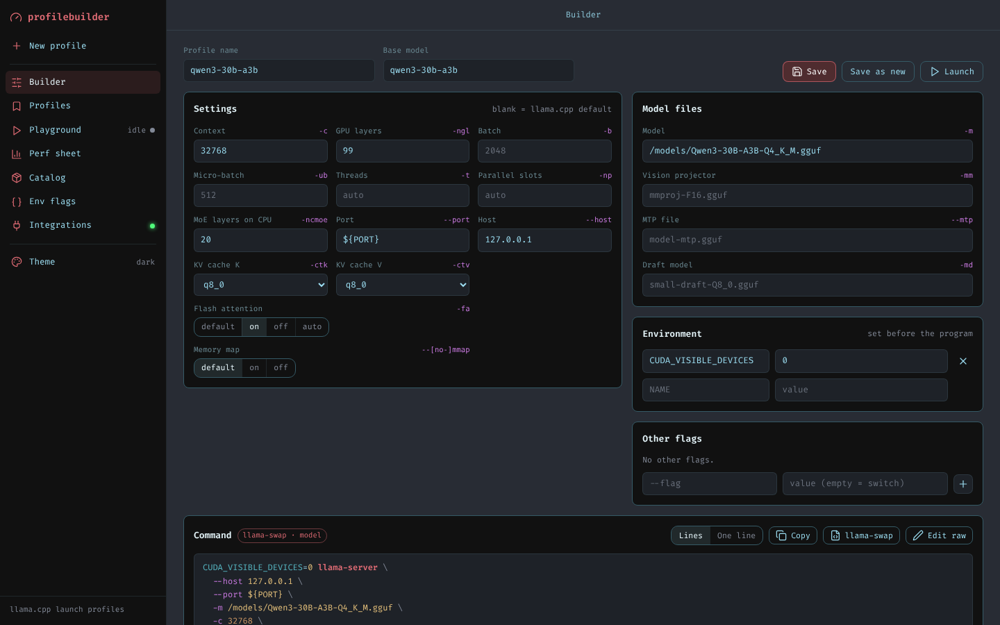
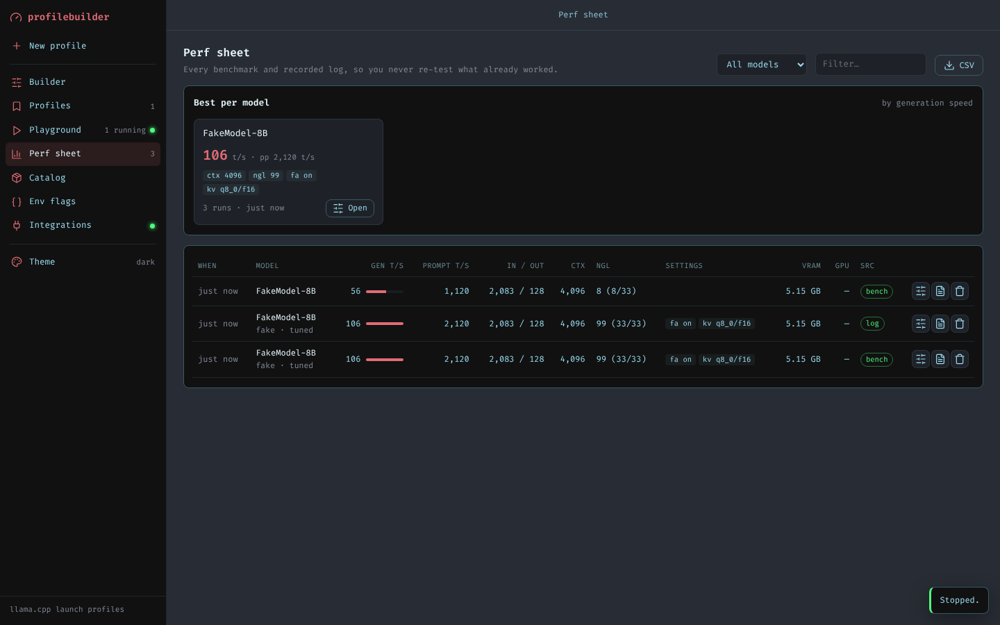

# llamacpp-profilebuilder

Launch command builder for llama.cpp that integrates with Odysseus and llama-swap. Paste or import a `llama-server` command, tune it with real controls, launch it, benchmark it, and keep every result so you never re-test what already worked.



## What it does

- **Builder.** Paste a command, or import one from a saved profile, an Odysseus cookbook or a llama-swap config. Context, GPU layers, batch sizes, threads, KV cache types, flash attention, mmap, MoE offload, the vision projector, MTP and draft model all become form fields. Flags you don't touch stay exactly where they were, spelled the way you wrote them (`-ngl` stays `-ngl`). Unknown flags and repeated ones such as several `-ot` overrides are kept and editable. Copy the result, or export it as a llama-swap `models:` entry with `--port ${PORT}`.
- **Profiles.** Saved commands live on the server, and you can retarget them at another model in one click.
- **Playground.** Launches the command in its own process group with a captured log. `${PORT}` becomes a free port. The playground waits for `/health`, then benchmarks through `/completion` using a fixed prompt size and `ignore_eos`. While the request runs it samples `nvidia-smi` if one is present. **Record from log** stores timings found in the output instead, which covers `llama-cli` and `llama-bench`.
- **Perf sheet.** Every run is stored with generation and prompt speed, token counts, context, layers offloaded, VRAM (from the log's GPU buffer sizes), GPU %, and the settings that produced it. You also get the best result per model, sorting, filtering and CSV export.
- **Catalog.** Register mmproj and MTP files per base model; they appear as suggestions in the builder.
- **Env flags.** A reference of the env vars that matter for llama.cpp, CUDA, ROCm and Vulkan, plus the last speed seen with each one set.
- **Integrations.** Read-only import from Odysseus' `cookbook_state.json` and llama-swap's `config.yaml`, with macros expanded. Also shows a live llama-swap status.



## Run it

```sh
pip install -r requirements.txt
python -m src.app          # or: python src/app.py
```

Open http://localhost:7861. Stopping the app (Ctrl+C or SIGTERM) also stops anything it launched.

| Variable | Default | |
| --- | --- | --- |
| `PROFILEBUILDER_DB` | `./data.db` | SQLite file for profiles, runs and the catalog |
| `PROFILEBUILDER_RUNS_DIR` | `./runs` | One log file per launch |
| `ODYSSEUS_COOKBOOK` | — | Path or URL of Odysseus' `cookbook_state.json`. Mounting the file is the reliable route, because Odysseus' API only answers admin requests from loopback. |
| `LLAMA_SWAP_CONFIG` | — | llama-swap `config.yaml`, or a directory of yaml files |
| `LLAMA_SWAP_URL` | — | Running llama-swap, e.g. `http://127.0.0.1:8080` |
| `HOST` / `PORT` | `0.0.0.0` / `7861` | Bind address |

**Security:** the playground runs whatever command it is given, with this app's permissions. There is no login. Only expose the port where everyone who can reach it is allowed to run programs on the machine. Otherwise set `HOST=127.0.0.1`.

A database from the first version of this app (`mtp_models`, `vision_mmjogs`, old `profiles` columns) is migrated in place on startup. Profiles that version kept in browser storage move to the server the first time you open the new UI.

## Tests

```sh
pip install -r requirements-dev.txt
pytest
```

The tests launch `tests/fake_llama_server.py` instead of a real model. It's a tiny HTTP server that prints llama-server's log format and answers `/health` and `/completion`, so the full launch → benchmark → record path runs without a GPU. You can use it in the playground too:

```sh
python tests/fake_llama_server.py --port ${PORT} -ngl 99
```
