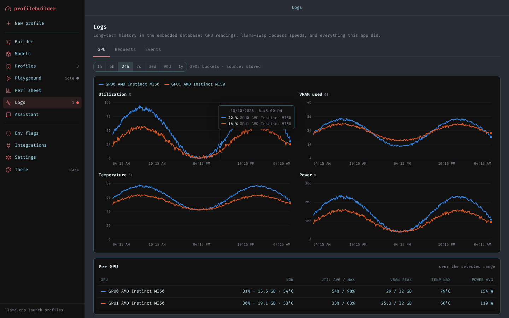

# llamacpp-profilebuilder

Launch command builder for llama.cpp that integrates with Odysseus and llama-swap. Pick a model from your library or download one, tune its `llama-server` command with real controls, save as many personal profiles per model as you like, benchmark them, and keep long-term GPU and speed history in an embedded database. A small local assistant can answer questions about that history.


## What it does

- **Models.** Scans your models folder the way llama-swap-rescan's modelscan does. It skips non-first shards of split files, pairs `mmproj-*.gguf` files with the model next to them, and uses llama-swap's own model IDs.
  - **Prefabs:** every file gets a ready-made command, built from your defaults in Settings → Prefab. Embedding models get `--embedding --pooling mean`. Vision models get `--mmproj … --image-max-tokens 1024`. MTP models get `--spec-type draft-mtp --spec-draft-n-max 3` and `LLAMA_ENABLE_MTP_OPT=1`.
  - **Downloader:** search Hugging Face, see every quant with its size and whether it fits your VRAM, and download with progress, cancel and resume (`.part` files plus HTTP Range). Files land in `<models>/<repo-name>/`, where llama-swap's modelscan picks them up.
- **Builder.** Paste or import a command, or open a prefab. Every important flag is a form field: context, GPU layers, batch sizes, threads, KV cache types, flash attention, mmap, `-lm` load mode, `--fit`, split mode, MoE offload, vision projector, draft model and speculative type. In **Odysseus format** (the default), commands use the Cookbook's own shape: `llama-server --model "<gguf>" --host 0.0.0.0 --port N -ngl N -c N …`. The builder also understands what Odysseus writes: `export K=V` lines and `--model "$(printf %s '…')"`.
- **Profiles.** No limit on profiles; the Cookbook caps saves at five per model. Each profile is filed under its model, so you can filter and star them per model.
- **Playground and perf sheet.** Launch, wait for `/health`, then benchmark through `/completion`. Results are stored with speeds, VRAM, layers offloaded and settings.
- **Logs (long-term, in SQLite).**
  - **GPU history** for every card: utilization, VRAM, temperature and power. Raw readings are kept for a set number of days, and hourly rollups forever. Charts cover 1h to 1y.
  - **Request history:** llama-swap's per-request speeds, copied in so they outlive llama-swap's own retention.
  - **Events log:** launches, crashes with the error line, benchmarks, downloads, profile changes and settings changes.
- **Assistant.** One continuous chat with Qwen3-0.6B, or any model you choose.
  - Every turn it gets a compact block of facts from the database: GPU now / last hour / last day / last week, request speeds per model, best benchmarks, running launches and recent errors. A 0.6B model can then answer from real numbers.
  - When the chat no longer fits the context window, older turns are summarised into a running summary. They stay visible but are no longer sent.
  - **Reset chat** clears everything. **What it sees** shows the exact facts block.
- **Export for llama-swap.** Your profiles are served at `GET /api/cookbook/state` in Odysseus' `cookbook_state.json` format, and can also be written to a file. llama-swap-rescan's Odysseus integration reads it exactly as it reads Odysseus, so every profile becomes a variant `<model-id>--<profile name>`. Odysseus' own presets pass through, so pointing llama-swap here keeps them.



## Run it

```sh
pip install -r requirements.txt
python -m src.app          # or: python src/app.py
```

Open http://localhost:7861. Stopping the app (Ctrl+C or SIGTERM) also stops anything it launched.

Environment variables set the defaults; Settings in the UI overrides them (stored in the database).

| Variable | Default | |
| --- | --- | --- |
| `MODELS_DIR` | `./models` | Model library and download target. Mount the same folder llama-swap scans (`/app/models`). |
| `LLAMA_SWAP_URL` | — | e.g. `http://llama-swap:8080`. GPU readings come from its `/api/performance` (so this container needs no GPU access), request history from `/api/metrics/activity`. |
| `ODYSSEUS_COOKBOOK` | — | Odysseus' `cookbook_state.json`, e.g. the read-only mount llama-swap uses (`/app/odysseus-data/cookbook_state.json`). |
| `COOKBOOK_EXPORT_FILE` | — | Also write the Odysseus-format state here, for llama-swap's `stateFile` mode. |
| `LLAMA_SWAP_CONFIG` | — | llama-swap `config.yaml` (or a directory of yaml files) to import commands from. |
| `HF_ENDPOINT` / `HF_TOKEN` | huggingface.co / — | Mirror and token for gated repos. |
| `PROFILEBUILDER_DB` | `./data.db` | The embedded database. |
| `PROFILEBUILDER_RUNS_DIR` | `./runs` | One log file per launch. |
| `PROFILEBUILDER_TELEMETRY` | `1` | `0` turns the background collector off. |
| `HOST` / `PORT` | `0.0.0.0` / `7861` | Bind address. |

Without a llama-swap URL, GPU readings are read locally from AMD sysfs (`/sys/class/drm`) or `nvidia-smi`.

**Security:** the playground runs whatever command it is given, with this app's permissions. There is no login. Only expose the port where everyone who can reach it is allowed to run programs on the machine. Otherwise set `HOST=127.0.0.1`.

### Pointing llama-swap at it

In llama-swap's `config.yaml` (Integrations shows these with your real values filled in):

```yaml
odysseus:
  enabled: true
  baseURL: "http://profilebuilder:7861"   # same Docker network
  token: "any"                            # llama-swap needs a value; set Settings → Export → token to enforce one
  refreshSeconds: 60
  profilePrefix: "pb"
  outputFile: "/app/config.d/odysseus.generated.yaml"
  ensureDio: true
```

Or share a volume, set `COOKBOOK_EXPORT_FILE`, and use `stateFile:` instead of `baseURL:`. Every exported command has a `.gguf` path after `--model` and a `--port`, which llama-swap's parser requires. Profiles that point at something else (an `-hf` repo, a wrapper script) are skipped, with a warning on the Integrations page.

### The assistant's model

**Assistant → Set up Qwen3-0.6B** reuses a Qwen3-0.6B GGUF already in your models folder, or downloads the Q8_0 (under 1 GB) from `Qwen/Qwen3-0.6B-GGUF`. It then creates the profile `Assistant · Qwen3-0.6B`: your prefab defaults plus `--host 127.0.0.1 --port ${PORT} -c 8192`. It runs with thinking off and Qwen's recommended non-thinking sampling.

- **Managed** (default): this app launches that profile on first message. That needs `llama-server` and GPU access in this container.
- **Endpoint**: if this app runs in a plain container, let llama-swap serve the model instead. Download it here into the shared models folder, rescan llama-swap, then set Settings → Assistant to `endpoint`, `http://llama-swap:8080/v1`, model `qwen3-0.6b-q8_0`.

Any profile can be the assistant. Set **Context window** in Settings to the profile's `-c`, since compaction starts at about 70% of it.

Databases from earlier versions are migrated in place on startup, and profiles the first version kept in browser storage move to the server.

## Tests

```sh
pip install -r requirements-dev.txt
pytest
```

The tests use stand-ins instead of real services: `tests/fake_llama_server.py` (prints llama-server's log format and serves `/health`, `/completion` and `/v1/chat/completions`), plus in-process fakes of the Hugging Face Hub and of llama-swap-rescan's API in `tests/fakes.py`. The full launch → benchmark → record path, downloads with resume, telemetry and the assistant all run without a GPU or network. Exported presets are checked against the same rules llama-swap-rescan's `ParseCommand` applies.
