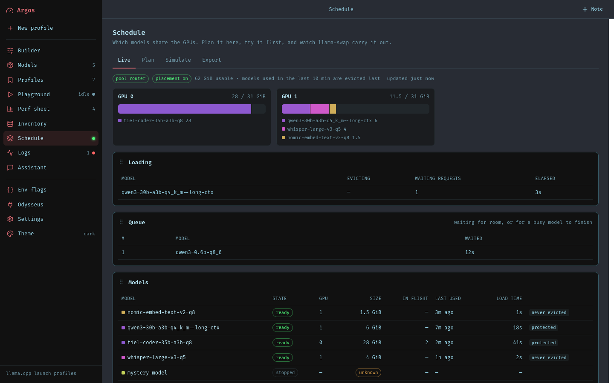
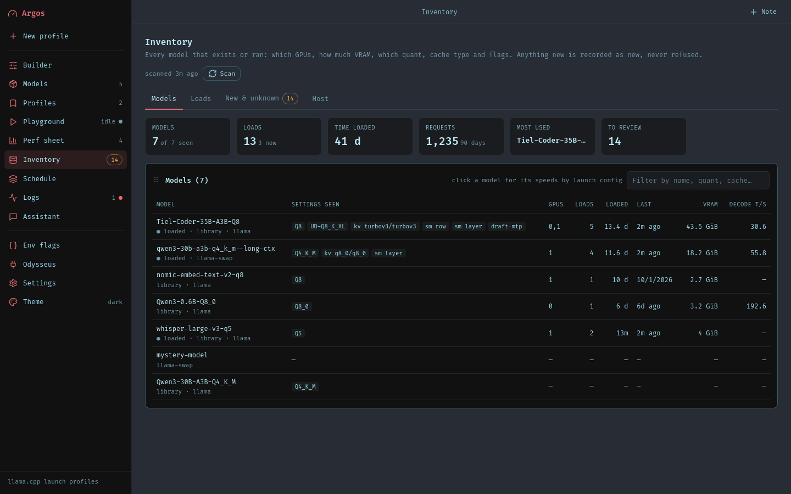
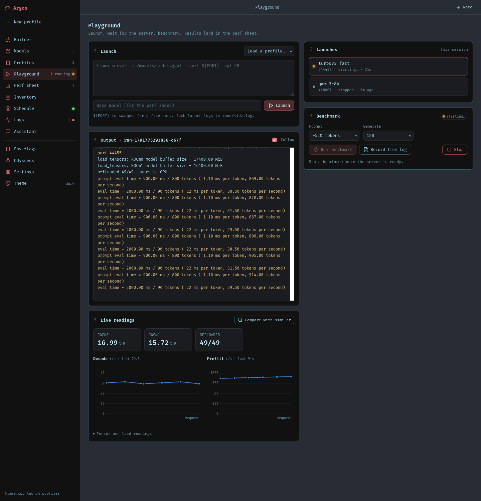
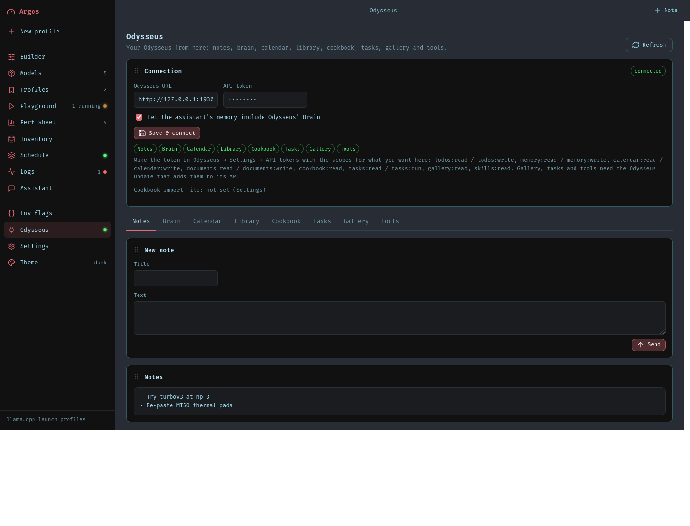

# Argos

**Run llama.cpp models on your own GPUs. Build the command, load the models, watch it all.**

Argos is the control panel for your local llama.cpp. It does not replace `llama-server`. That stays the thing that runs your models. Argos decides which models are loaded, on which GPU, and shows you how fast they run.

It is two parts in one repo:

- **The engine** (Go, in the root). A fork of [llama-swap](https://github.com/mostlygeek/llama-swap) with a smarter scheduler.
- **The builder** (Python, in `builder/`). The web page where you build presets, test them and watch everything.



## What you get

- **Builder.** Tune a `llama-server` command with simple controls. Save as many presets as you want.
- **Models.** See every model file you have. Download new ones from Hugging Face.
- **Scheduler.** All your models share the GPUs. Argos loads what fits, and only unloads a model when it has to. It is the engine in this repo.
- **Playground.** Launch a model, run a speed test, and watch speed per request while it works.
- **Inventory.** Every model and every launch, remembered. New quants and flags never break it.
- **Logs.** GPU use, speed per request, and events. From 30 seconds back to a year.
- **Assistant.** A small model that knows your history and answers questions about it.
- **Odysseus.** Notes, Brain, Calendar, Library, Cookbook, Tasks, Gallery and Tools, right inside Argos.
- **Themes.** The same themes as Odysseus, or make your own.







_Screenshots use demo data._

## Run it

Engine:

```sh
make clean all
build/llama-swap -config config.yaml -config-dir config.d -watch-config
```

Builder:

```sh
cd builder
pip install -r requirements.txt
python -m src.app
```

Open http://localhost:7861. The original llama-swap docs are in [docs/llama-swap.md](docs/llama-swap.md).

## Connect it

| Setting | What it is |
| --- | --- |
| `LLAMA_SWAP_URL` | Your Argos engine, for example `http://llama-swap:8080`. |
| `MODELS_DIR` | The folder with your model files. Use the same one the engine scans. |
| `ODYSSEUS_COOKBOOK` | Odysseus' `cookbook_state.json`, to import your Cookbook presets. |
| `HF_TOKEN` | Hugging Face token, only for gated models. |
| `ARGOS_DB` | Where Argos keeps its data. Default `./data.db`. |

Everything here can also be set in **Settings**. To connect Odysseus, open the **Odysseus** page and paste your URL and an API token.

**Security:** the Playground runs whatever command you give it, and there is no login. Only expose the port to people you trust.

## Tests

```sh
make test-dev                              # engine
cd builder && pip install -r requirements-dev.txt && pytest
```

The tests use stand-ins instead of real services: `tests/fake_llama_server.py` (prints llama-server's log format and serves `/health`, `/completion` and `/v1/chat/completions`), plus in-process fakes of the Hugging Face Hub and of llama-swap-rescan's API in `tests/fakes.py`. The full launch → benchmark → record path, downloads with resume, telemetry and the assistant all run without a GPU or network. Exported presets are checked against the same rules llama-swap-rescan's `ParseCommand` applies.
